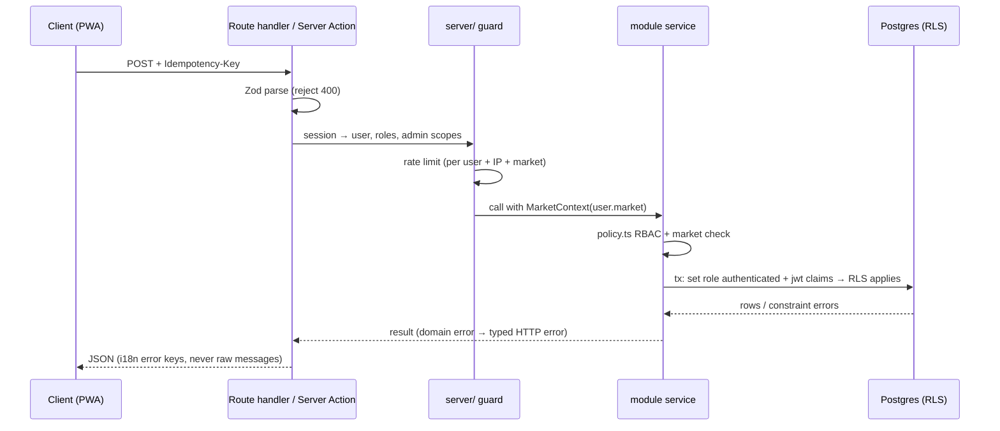

# 01 — Stack & structure

## 1. Stack confirmation

| Concern | Decided | Notes / things I need you to confirm |
|---|---|---|
| Framework | Next.js 15 App Router + TypeScript (strict) | Next.js 16 is current as of this writing. I'll stay on **15.x** as instructed unless you say otherwise. |
| PWA | Web app manifest, service worker (Serwist), offline app shell, Web Push (VAPID) | iOS push requires the PWA be installed to the home screen (iOS 16.4+). SMS is the fallback channel for critical events. |
| DB | Supabase Postgres, **eu-west-2 (London)** | PostGIS extension for service-area polygons and pin-in-area checks. |
| ORM / migrations | Drizzle ORM + drizzle-kit | RLS policies, triggers and constraint triggers live in hand-written SQL migrations next to the generated ones. |
| Auth | **Supabase Auth (phone OTP)** — *confirm* | Not named explicitly in the brief, but RLS with `auth.uid()` makes it the natural fit. See §3 for how it meets Termii/Twilio. |
| Storage | Supabase Storage | Private buckets with RLS: `errand-media`, `proofs`, `receipts`, `kyc` (we keep only references; documents stay with Dojah/Sumsub), `payout-exports`. |
| Realtime | Supabase Realtime | **Broadcast on private channels** authorised by RLS on `realtime.messages`, fed by DB triggers. This scales better than Postgres Changes and keeps RLS in force. |
| UI | Tailwind CSS + shadcn/ui (restyled to tokens) | Logical CSS properties (`ms-`/`me-`, `start`/`end`) everywhere for RTL. |
| Jobs | Inngest | Auto-release, reminders, expiry, payout batches, KYC/payment reconciliation sweeps. |
| Validation / forms | Zod + React Hook Form | Zod schemas are shared client/server, and the server re-validates. |
| i18n | next-intl | Locale-prefixed routes `/[locale]/…`. `Intl.NumberFormat`/`DateTimeFormat` for all formatting. Currency precision comes from **our config**, not Intl defaults. |
| Phone | libphonenumber-js | Accepted countries come from `markets.phone_regions` (one or more per market); calling codes come from libphonenumber, not hardcoded. |
| Hosting | Vercel, functions region `lhr1` | Webhook routes are Node runtime (crypto, raw body). |
| Tests | Vitest (unit), Vitest + Testcontainers Postgres or Supabase local (integration), Playwright (e2e, Stage 4+) | Money, ledger, tax and state-machine tests from Stage 3 onward. |
| Package manager | pnpm | |
| Observability | *Proposal:* Sentry + Vercel logs, structured JSON logs with `market`, `request_id`, `errand_id` | Needs your OK (extra account). |

## 2. Repository layout

A single Next.js app with strict module boundaries. A monorepo isn't worth it yet, and the layout below can split into packages later without code changes.

```
.
├── .env.example
├── drizzle.config.ts
├── supabase/
│   ├── config.toml                 # local dev stack
│   └── seed/                       # markets, service areas (GeoJSON), categories, prohibited items
├── db/
│   ├── schema/                     # Drizzle table definitions, one file per domain
│   ├── migrations/                 # drizzle-kit output + hand-written *.sql (RLS, triggers)
│   └── client.ts                   # regional router: dbFor(market) → Drizzle instance (see 07)
├── messages/                       # i18n catalogs: en.json (+ future locales)
├── src/
│   ├── app/
│   │   ├── [locale]/
│   │   │   ├── (marketing)/        # homepage, market picker, become-a-runner, business, rides teaser
│   │   │   ├── (customer)/         # post errand, my errands, checkout, chat
│   │   │   ├── (runner)/           # browse, offers, active jobs, earnings, KYC
│   │   │   └── (admin)/admin/      # market-scoped admin
│   │   └── api/
│   │       ├── webhooks/[provider]/[market]/route.ts   # e.g. /api/webhooks/paystack/ng
│   │       ├── auth/sms-hook/route.ts                   # Supabase Send-SMS hook → SmsProvider
│   │       └── inngest/route.ts
│   ├── modules/                    # DOMAIN — no provider imports, no Next imports
│   │   ├── markets/                # MarketContext, config loading, fee schedules, runner rules
│   │   ├── identity/               # users, roles, admin scopes, profiles, blocks/reports
│   │   ├── kyc/
│   │   ├── places/                 # addresses, landmarks, service-area checks
│   │   ├── errands/                # aggregate, state machine, categories, prohibited-item screening
│   │   ├── offers/
│   │   ├── messaging/
│   │   ├── notifications/
│   │   ├── pricing/                # quote(), fee lines, tax step, rounding
│   │   ├── ledger/                 # chart of accounts, postJournal(), balances
│   │   ├── payments/               # payment intents, top-ups, refunds, webhook event handling
│   │   ├── payouts/                # automated + batch payouts, export generation
│   │   ├── disputes/
│   │   └── ratings/
│   │   # each module: domain/ (pure), service.ts (use cases), repo.ts, schemas.ts (Zod), policy.ts (RBAC)
│   ├── providers/                  # ADAPTERS — implement interfaces from src/providers/types.ts
│   │   ├── types.ts
│   │   ├── registry.ts             # adapter key (from markets row) → factory(credentials)
│   │   ├── payment/{paystack,scotia-ecom,sandbox}/
│   │   ├── payout/{paystack-transfers,bank-batch,sandbox}/
│   │   ├── kyc/{dojah,sumsub,sandbox}/
│   │   ├── sms/{termii,twilio,sandbox}/
│   │   └── maps/{google,sandbox}/
│   ├── jobs/                       # Inngest functions (thin; call module services)
│   ├── server/                     # request plumbing: session, RBAC guard, idempotency, rate limit, errors
│   ├── lib/                        # money, phone, i18n format helpers, ids (UUIDv7), crypto
│   └── ui/                         # design system: tokens, primitives (restyled shadcn), patterns
└── tests/
    ├── unit/                       # pure domain: money, pricing, tax, ledger, state machine
    ├── integration/                # DB + RLS + webhooks per provider (recorded fixtures)
    └── e2e/
```

**Enforced boundaries** (ESLint `no-restricted-imports` + dependency-cruiser in CI):
- `src/modules/**` must not import `src/providers/**` (only `src/providers/types.ts`), `next/*`, or `src/app/**`.
- `src/modules/*/domain/**` is pure: no DB, no I/O. This is where money, tax, and state-machine logic live and get unit-tested.
- Only `db/client.ts` knows connection strings and regions.

## 3. Auth: how phone OTP meets Termii / Twilio Verify

Supabase Auth natively supports Twilio and Twilio Verify, but not Termii. Two options:

| Option | How | Trade-off |
|---|---|---|
| **A (recommended)** | Supabase Auth phone OTP + **Send SMS Auth Hook** → our `/api/auth/sms-hook` → `SmsProvider` chosen by the phone's market. Supabase generates and checks the code; Termii (NG) and Twilio Messaging (VC) only deliver it. | One OTP path for every market, native Supabase sessions, RLS just works. VC uses **Twilio Programmable Messaging** rather than Twilio Verify. |
| B | Our own OTP endpoints calling Termii Token API / Twilio Verify, then minting a Supabase session server-side. | Keeps Twilio Verify's fraud tooling, but session minting for phone-only users is a workaround and is more security-sensitive code to own. |

**I need you to choose.** The brief says "Twilio Verify". Option A swaps it for Twilio Messaging inside the same Twilio account. If you choose A, the `SmsProvider` interface still has `startVerification`/`checkVerification` so Verify can come back later.

## 4. Request lifecycle (every mutating call)



Two DB access modes:
- `asUser(session)`: wraps each transaction in `set local role authenticated` with the JWT claims, so **RLS is enforced even for server code** acting for a user.
- `asSystem(reason)`: service role, used only by webhooks, Inngest jobs and admin use cases that pass `policy.ts`. Every call is logged with its reason.
