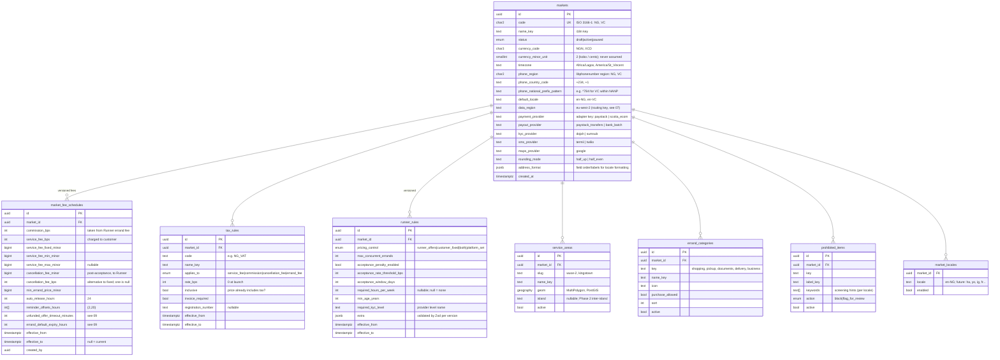
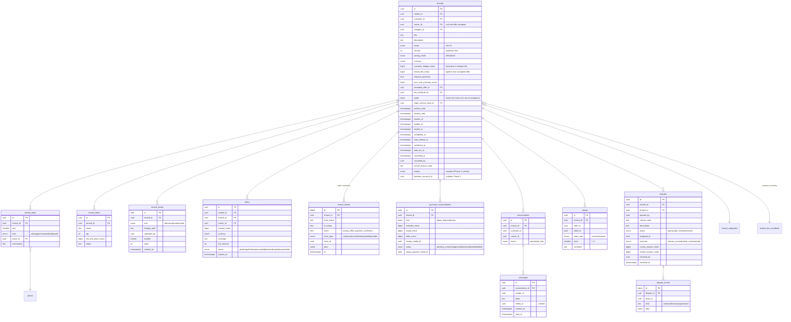
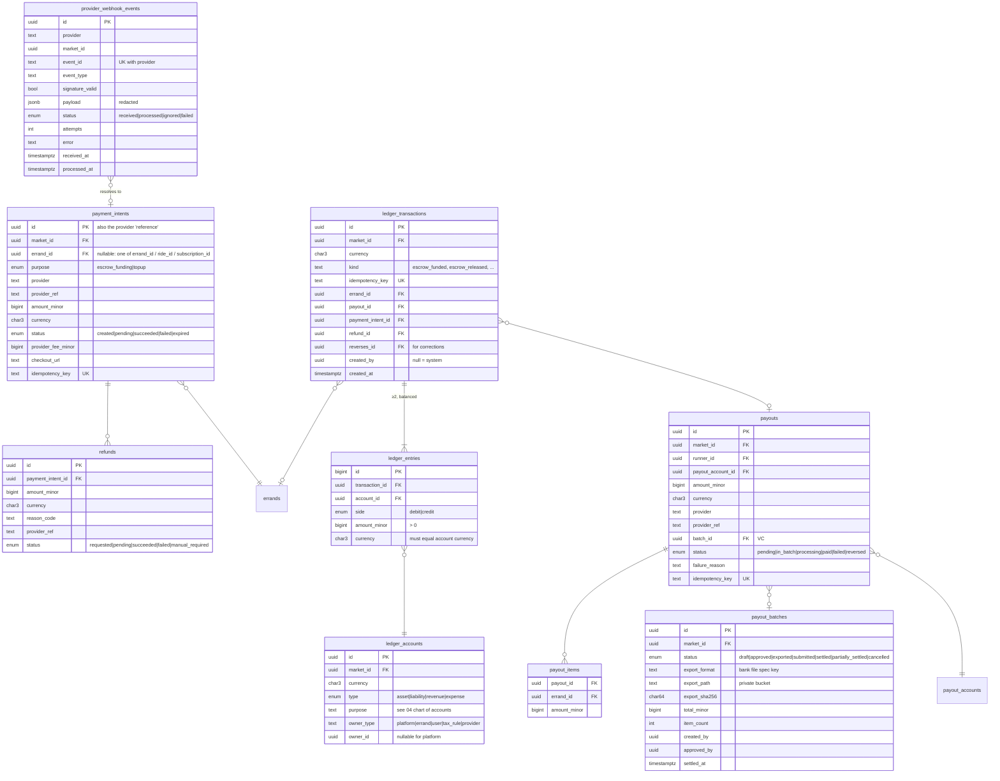
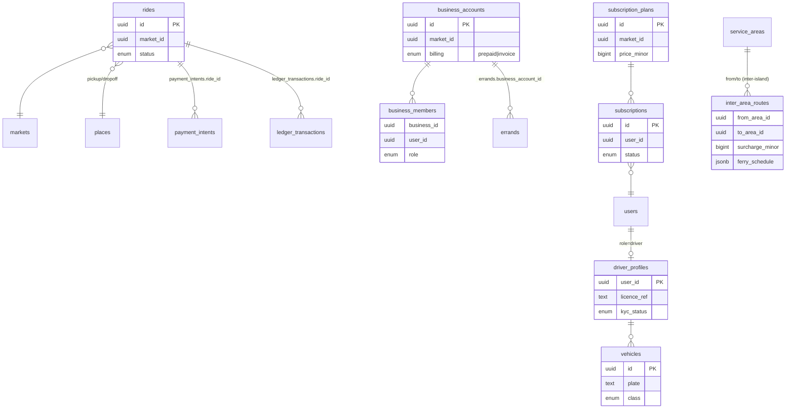

# 02 — Data model

Conventions:
- PKs are **UUIDv7** (time-ordered, globally unique, so they're safe when a market moves to another regional DB later).
- Money columns: `*_minor bigint` + `currency char(3)`. No floats or `numeric` money anywhere.
- Percentages are stored as **basis points** (`int`, 1 bps = 0.01%).
- Timestamps are `timestamptz` (UTC). Display uses `markets.timezone` (or the user's locale/timezone).
- `market_id` is on every market-owned row. Composite FKs `(market_id, id)` are used where two rows must share a market (e.g. offer ↔ errand ↔ runner), so the DB itself rejects cross-market joins.
- Soft-delete (`deleted_at`) only on user-facing content. Financial and audit tables are append-only.
- Dashed boxes in the Phase 2 diagram are **designed, not built**.

## 1. Market configuration

**Why fee schedules and runner rules are versioned rows** rather than columns on `markets`: when an admin edits a fee, errands already in flight must keep the fees the customer agreed to. At funding time an errand stores `fee_schedule_id` plus a `quote` snapshot, and the audit trail shows who changed what and when.

## 2. Identity, roles, profiles, trust

```mermaid
erDiagram
  users ||--o{ user_roles : ""
  users ||--o{ admin_grants : ""
  users ||--o| customer_profiles : ""
  users ||--o| runner_profiles : ""
  users ||--o{ kyc_verifications : ""
  users ||--o{ payout_accounts : ""
  users ||--o{ places : "saved"
  users ||--o{ push_subscriptions : ""
  users ||--o{ blocks : "blocker"
  users ||--o{ reports : "reporter"
  runner_profiles }o--o{ service_areas : "runner_service_areas"

  users {
    uuid id PK "= auth.users.id"
    uuid market_id FK "home market; Runner may only work here"
    text phone_e164 UK
    text display_name
    text email "nullable"
    text locale
    enum status "active|suspended|banned|deleted"
    timestamptz created_at
  }
  user_roles {
    uuid user_id FK
    enum role "customer|runner|admin|driver(reserved)|business_member(reserved)"
    enum status "active|revoked"
    timestamptz granted_at
    uuid granted_by
  }
  admin_grants {
    uuid id PK
    uuid user_id FK
    uuid market_id FK "NULL = all markets"
    text[] permissions "ops, finance, support, config, super"
    timestamptz granted_at
    uuid granted_by
  }
  customer_profiles {
    uuid user_id PK
    uuid default_place_id
  }
  runner_profiles {
    uuid user_id PK
    uuid market_id FK
    enum kyc_status "not_started|pending|approved|rejected|expired"
    timestamptz kyc_approved_at
    enum availability "offline|online"
    enum vehicle "none|bicycle|motorbike|car (Phase 2 reuse)"
    text bio
  }
  kyc_verifications {
    uuid id PK
    uuid user_id FK
    uuid market_id FK
    text provider "dojah | sumsub"
    text provider_ref
    text level
    enum status "created|submitted|provider_approved|provider_rejected|admin_approved|admin_rejected"
    jsonb result_summary "normalized, no raw ID numbers"
    text id_number_hash "HMAC, for duplicate-account detection"
    uuid reviewed_by
    text review_reason
    timestamptz created_at
  }
  payout_accounts {
    uuid id PK
    uuid user_id FK
    uuid market_id FK
    enum method "bank_transfer (mobile_money later)"
    text bank_code
    bytea account_number_enc "app-level encrypted"
    text account_last4
    text account_name "from name enquiry"
    text provider_recipient_ref "Paystack recipient_code"
    timestamptz verified_at
    bool is_default
  }
  places {
    uuid id PK
    uuid market_id FK
    uuid user_id FK "nullable (one-off errand stops)"
    text label
    geography point "map pin (required)"
    text landmark_note "free text, required-or-encouraged"
    text contact_name
    text contact_phone_e164
    text formatted_address "nullable"
    uuid service_area_id FK "computed by ST_Covers"
  }
  push_subscriptions {
    uuid id PK
    uuid user_id FK
    text endpoint
    jsonb keys
  }
  blocks {
    uuid blocker_id
    uuid blocked_id
  }
  reports {
    uuid id PK
    uuid market_id
    uuid reporter_id
    text subject_type "user|errand|message"
    uuid subject_id
    text reason_code
    enum status "open|actioned|dismissed"
    uuid assigned_to
  }
```

Notes:
- **One account, many roles.** A person is one `users` row. `customer` and `runner` are independent rows in `user_roles`. A Runner can't make an offer on their own errand (DB check).
- **Runner eligibility** to accept or offer = `runner` role active AND `runner_profiles.kyc_status = 'approved'` AND `users.market_id = errand.market_id` AND not blocked either way. This is checked in `policy.ts`, RLS and an `offers` insert trigger.
- **Admin scope**: `admin_grants.market_id IS NULL` means global. RLS helper `auth_admin_markets()` returns the set of markets the admin can see.
- The `kyc` storage bucket holds nothing by default. Document images stay with Dojah/Sumsub, and we store references plus a normalized summary (data-minimisation; see 08).

## 3. Errands, offers, messaging, ratings, disputes

Notes:
- **Conversations are per (errand, runner).** That supports pre-acceptance Q&A if you want it (see 09) and makes a conversation read-only once a different Runner is chosen.
- **Notifications**: `notifications (user_id, market_id, type, payload, read_at)` + `notification_deliveries (notification_id, channel push|sms|in_app, provider, provider_ref, status)`. Omitted from the diagram for space.
- **`errand_events`** is the single audit log of the state machine, written in the same transaction as the status change.

## 4. Money: payments, ledger, payouts

Ledger invariants enforced **in Postgres**, not just in code:
1. `ledger_entries.amount_minor > 0`, and `side` decides the direction.
2. A **deferred constraint trigger** checks Σdebits = Σcredits per transaction at commit.
3. An entry's currency must equal its account's currency, and all entries in a transaction share one currency. This is how "no FX" is enforced.
4. `UPDATE`/`DELETE` on `ledger_*` is revoked from every role, so corrections must be reversing transactions.
5. `ledger_transactions.idempotency_key` is unique, so a replayed webhook can't double-post.

Balances come from the view `ledger_balances(account_id, debit_total, credit_total, balance)`. If volume needs it later, we can add a *derived* checkpoint table (rebuildable from entries). It would never be the source of truth.

## 5. Phase 2 (designed, not built)

What we put in the MVP so these slot in without rewrites:

| Phase 2 feature | MVP hook already present |
|---|---|
| Ride-hailing | `places` is shared. `payment_intents` and `ledger_transactions` use "one-of nullable FKs" (`errand_id` now, `ride_id` added later with a CHECK). `MapsProvider` already has `route()`/`eta()`. `driver` is reserved in the role enum. |
| Driver accounts | Role enum value reserved. KYC tables are role-agnostic (`kyc_verifications.level`). |
| Corporate accounts | `errands.business_account_id` nullable. `admin_grants.permissions` style reused for `business_members.role`. |
| Subscriptions | Ledger and payment intent purposes are open enums (text + check), so adding `subscription_charge` is additive. |
| Priority fulfilment | `errands.priority` column (default `standard`). Fee schedule can gain `priority_fee_*` columns. |
| Inter-island (SVG) | `service_areas.island`. Multi-stop `errand_stops`, each with its own `place.service_area_id`. Errands aren't tied to one area. |
| New countries | New `markets` row + fee schedule + tax rules + runner rules + polygons + categories + translations. |

## 6. RLS strategy (summary)

Every table has RLS enabled with **default deny**. Helper SQL functions (`security definer`, `stable`):
`auth_user_market()`, `auth_has_role(role)`, `auth_admin_markets()`, `auth_is_participant(errand_id)`.

| Table group | Customer | Runner | Admin |
|---|---|---|---|
| `markets`, categories, service areas, prohibited items | read active | read active | read/write in scope |
| `errands` | own | `open` in own market (limited columns via view) + assigned | in scope |
| `offers` | on own errands | own | in scope |
| `messages` | participant | participant | in scope (support) |
| `payment_intents`, `refunds` | own errands (read) | — | in scope |
| `ledger_*` | via `my_transactions` view only | via `my_earnings` view only | finance permission in scope |
| `payouts`, `payout_accounts` | — | own | finance in scope |
| `kyc_verifications` | — | own (status only) | in scope |
| `provider_webhook_events` | — | — | finance/ops in scope |

All money and state-changing writes go through server use cases. Clients have no direct `insert`/`update` on errands, offers or money tables. RLS on those exists so that a leaked anon key or a buggy query can't read across users or markets.

Pre-acceptance privacy: Runners browsing open errands see a **view** that exposes the service area and an approximate location (rounded to around 500 m), not the exact pin, contact phone or landmark. They see full details after funding.
