# 03 — Errand state machine

Implemented as a **pure, table-driven function** in `src/modules/errands/domain/state-machine.ts`:

```ts
transition(errand: ErrandSnapshot, event: ErrandEvent, actor: Actor, now: Date): TransitionResult
// → { next: ErrandStatus, effects: Effect[] } | { error: 'illegal_transition' | GuardFailure }
```

Effects (ledger postings, notifications, Inngest schedules) are returned as data and run by the service in the same DB transaction (or enqueued via an outbox row so a job can't fire for a rolled-back change). A Postgres trigger also rejects any `UPDATE errands SET status` that isn't in the allowed-transitions table, which protects against bugs in any code path.

## Diagram

```mermaid
stateDiagram-v2
  [*] --> draft
  draft --> open: publish [price ≥ market min, pins in service area, prohibited-item screen passes]
  draft --> cancelled: customer cancels

  open --> offer_accepted: customer accepts offer [runner KYC approved, same market, not blocked]
  open --> cancelled: customer cancels (free)
  open --> expired: expires_at reached (job)

  offer_accepted --> funded: payment_confirmed (verified webhook / server verify)
  offer_accepted --> open: funding timeout or payment failed (offer released)
  offer_accepted --> cancelled: customer or runner cancels (no funds held → free)

  funded --> in_progress: runner starts
  funded --> cancelled: cancel → cancellation fee to runner, remainder refunded
  funded --> disputed: either party raises issue

  in_progress --> completed_pending_confirmation: runner completes [proof photo; receipt reconciled if purchase]
  in_progress --> cancelled: cancel → cancellation fee to runner, remainder refunded
  in_progress --> disputed

  completed_pending_confirmation --> confirmed: customer confirms
  completed_pending_confirmation --> confirmed: auto-release at completed_at + window (job)
  completed_pending_confirmation --> disputed: customer disputes before auto-release

  disputed --> confirmed: admin resolves release_runner / split
  disputed --> refunded: admin resolves refund_customer (after refund settles)

  confirmed --> paid_out: payout settled (NG transfer.success / VC batch marked paid)
  cancelled --> refunded: refund settles (only when funds were held)

  paid_out --> [*]
  refunded --> [*]
  expired --> [*]
  cancelled --> [*]: nothing was funded
```



## Transition table

| From | Event | To | Actor | Guards | Effects |
|---|---|---|---|---|---|
| draft | `publish` | open | customer | category active in market; ≥1 stop; every pin inside an active `service_area` of the market (PostGIS `ST_Covers`); `customer_budget ≥ min_errand_price`; prohibited-item screen (`block` → reject; `flag_for_review` → see 09) | set `expires_at`; schedule `errand.expire`; notify eligible Runners in area |
| open | `accept_offer` | offer_accepted | customer | offer pending; Runner eligible (role, KYC approved, same market, not blocked, under `max_concurrent_errands`); offer amount ≥ min | other offers → `superseded`; compute and freeze `quote` + `fee_schedule_id`; create `payment_intent`; schedule funding timeout |
| offer_accepted | `payment_confirmed` | funded | provider | intent amount == quote total, currency matches, intent belongs to errand | ledger `escrow_funded`; open full-detail access for Runner; notify both |
| offer_accepted | `funding_timeout` / `payment_failed` | open | system | — | offer → `expired`; re-notify area |
| funded | `start` | in_progress | runner | is assigned Runner | if purchase: item-cost advance (see 04 and 09 Q1) |
| in_progress | `request_topup` | in_progress | runner | requires_purchase; before purchase | create `purchase_reconciliation(topup_request)`; customer approves → new `payment_intent(topup)` |
| in_progress | `complete` | completed_pending_confirmation | runner | ≥1 `proof` media; if purchase: `receipt` media + `actual_minor` recorded and any top-up funded | reconcile surplus (see 04); `auto_release_at = now + auto_release_hours`; schedule reminders at `reminder_offsets_hours` (push + SMS) and auto-release |
| completed_pending_confirmation | `confirm` | confirmed | customer | — | cancel reminder/auto-release jobs; ledger `escrow_released`; queue payout |
| completed_pending_confirmation | `auto_release` | confirmed | system | `now ≥ auto_release_at` and still in this state (re-read under row lock) | same as confirm; notify both |
| funded · in_progress · completed_pending_confirmation | `dispute` | disputed | customer / runner | before auto-release; not already disputed | **freeze**: cancel auto-release; no ledger movement (funds stay in escrow); open `disputes` row |
| disputed | `resolve` | confirmed / refunded | admin (scope + permission) | amounts sum to escrow balance | ledger split; refund via provider; payout queued |
| open · offer_accepted | `cancel` | cancelled | customer (open); customer or runner (offer_accepted) | — | free; void any unpaid intent |
| funded · in_progress | `cancel` | cancelled → refunded | customer / runner / admin | — | **customer-initiated**: `cancellation_fee` → Runner payable, rest refunded. **Runner-initiated**: see 09 Q6 |
| confirmed | `payout_settled` | paid_out | provider / admin | all payout items for errand settled | — |

## Concurrency and timers

- Every transition does `SELECT … FOR UPDATE` on the errand and checks `version`. Inngest jobs re-check state when they run, so a customer confirm racing the auto-release at hour 24 is safe and only one wins.
- Timers are stored on the row (`expires_at`, `auto_release_at`). Inngest `sleepUntil` runs the action, and a **sweeper cron** (every 5 min) catches anything a job missed. Both call the same idempotent use case.
- All timer durations come from the market fee schedule snapshot on the errand.
- User-facing times are rendered in the market timezone (or the viewer's), never server time.
