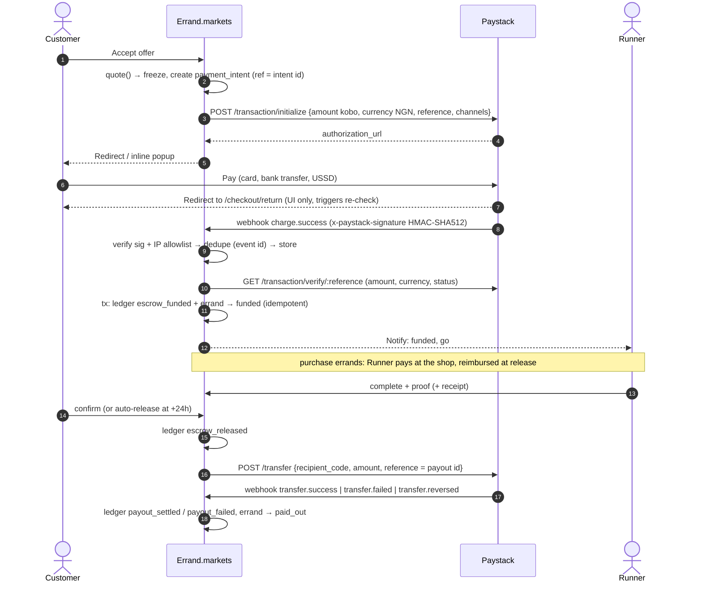
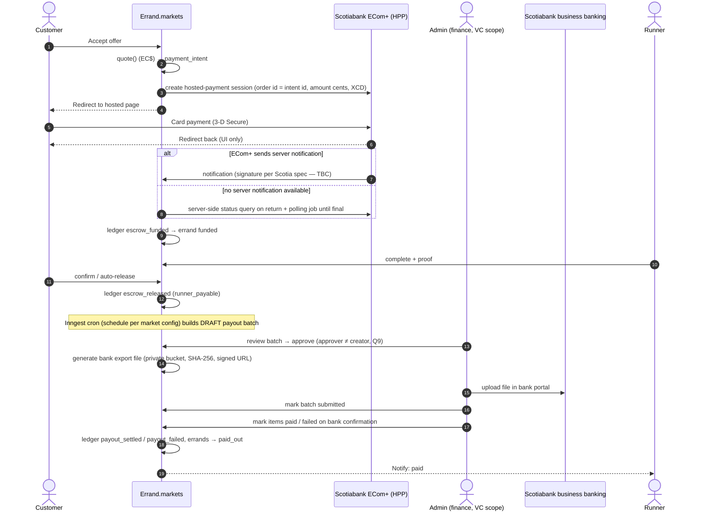

# 04 — Payments, fees, tax & ledger

> Decisions (2026-11-26, see [09](./09-open-questions.md)):
> - **Price:** set by the customer (editable while open); the first eligible Runner to accept gets the errand.
> - **Commission: 0 at launch** (`commission_bps = 0`). The commission and tax steps still run, so turning it on later is config only.
> - **Service fee: 5% of the errand price**, paid by the customer (not applied to item costs). **No minimum price.** The customer pays **after a Runner accepts**, including the **estimated item cost upfront**. `quote()` is implemented in `src/modules/pricing/domain/quote.ts` (integer-only, per-market rounding, tax step) and already powers the price breakdown customers see.
> - **Items:** the Runner buys with their own money and is **reimbursed when the errand is released**. This replaces the brief's "Runners never front their own money" rule, so there is no item-cost advance. Details still open: Q1a–Q1c.
> - **Paystack:** collect into the platform balance; release via the Transfers API (Q2).

## 1. Pricing pipeline (pure, in `src/modules/pricing/domain`)

```
quote(market, feeSchedule, taxRules, runnerRules, input) → Quote
input = { errandFeeMinor /* the customer's price */, itemCostEstimateMinor, requiresPurchase }
```

Steps, all integer math in minor units:
1. **Base lines**: `errand_fee`, `item_cost_estimate` (if purchase).
2. **Service fee** (customer pays): `clamp(round(errand_fee × service_fee_bps / 10_000) + service_fee_fixed, min, max)`. Which base it applies to (errand fee only, or errand fee + items) is **your decision (09 Q4)**.
3. **Commission** (deducted from Runner): `round(errand_fee × commission_bps / 10_000)`.
4. **Tax step**: for each `tax_rule` effective now and matching a line's `applies_to`:
   - exclusive: `tax = round(line × rate_bps / 10_000)`, added on top
   - inclusive: `tax = line − round(line × 10_000 / (10_000 + rate_bps))`, carved out of the line

   Every fee line passes through this step even when `rate_bps = 0`, so turning on a VAT later is config only.
5. **Rounding**: per line, using `markets.rounding_mode`. Splits (e.g. dispute 60/40) use largest-remainder allocation so totals always reconcile to the minor unit.
6. **Output**: `{ lines: [{code, amountMinor, taxMinor, payer, payee}], customerTotalMinor, runnerNetMinor, platformRevenueMinor, taxTotalMinor, currency, minorUnit, feeScheduleId, taxRuleIds }`, which is frozen onto `errands.quote` at acceptance.

Unit-tested with property tests (fast-check). Invariants: customer total = Σ customer lines; escrow = runner net + platform revenue + tax + item costs; no negative lines; works with minor units 0, 2 and 3 (JPY/XCD/KWD fixtures).

## 2. Chart of accounts (per market, per currency)

| Purpose | Type | Owner | Meaning |
|---|---|---|---|
| `provider_clearing` | asset | provider (`paystack`, `scotia_ecom`) | Money sitting at the PSP / merchant account |
| `bank_operating` | asset | platform | Platform bank account (VC payouts are paid from here) |
| `customer_escrow` | liability | errand | Funds held for one errand. **Must be 0 at every terminal state.** |
| `runner_payable` | liability | user (Runner) | Earned, not yet paid out |
| `payouts_in_transit` | liability | platform | Payout initiated, not yet confirmed |
| `refunds_payable` | liability | platform | Refund initiated, not yet confirmed |
| `tax_payable` | liability | tax_rule | Collected tax owed to authority |
| `commission_revenue` | revenue | platform | |
| `service_fee_revenue` | revenue | platform | |
| `provider_fees` | expense | provider | PSP processing fees, transfer fees |

## 3. Journal templates

`T` = customer total, `F` = errand fee, `C` = commission, `S` = service fee, `X` = taxes, `E` = item estimate, `A` = actual item cost.

| Kind | Trigger | Debit | Credit |
|---|---|---|---|
| `escrow_funded` | verified payment success | provider_clearing T | customer_escrow[errand] T |
| `provider_fee` | fee known from PSP | provider_fees f | provider_clearing f |
| `topup_funded` | verified top-up payment | provider_clearing Δ | customer_escrow Δ |
| `escrow_released` | confirm / auto-release | customer_escrow T | runner_payable (F − C − tax on C **+ A**, the receipt reimbursement), commission_revenue C (0 at launch), service_fee_revenue S, tax_payable X, refunds_payable (E − A) if the receipt is under the estimate |
| `cancellation_settled` | cancel after funding | customer_escrow T | runner_payable fee, refunds_payable remainder (service-fee treatment: Q5) |
| `refund_initiated` / `refund_settled` | admin/system → PSP confirm | customer_escrow → refunds_payable, then refunds_payable | refunds_payable, then provider_clearing |
| `payout_initiated` | payout created | runner_payable P | payouts_in_transit P |
| `payout_settled` | NG `transfer.success` / VC marked paid | payouts_in_transit P | provider_clearing (NG) / bank_operating (VC) |
| `payout_failed` | NG `transfer.failed`/`reversed`, VC marked failed | payouts_in_transit P | runner_payable P (back to payable) |
| `reversal` | admin correction | mirror of original | mirror of original |

Integration tests assert, for each scenario (happy path, surplus, top-up, cancel, dispute split, failed payout), that every `customer_escrow[errand]` ends at 0 and the trial balance is 0.

## 4. Nigeria — Paystack



Paystack specifics:
- **Escrow model (recommendation, Q2):** charges land in the platform's Paystack balance. Ask Paystack to configure settlement so enough balance is retained for Transfers (or settle to a dedicated account and top up the transfer balance). No subaccount split at charge time. Release = Transfer to the Runner's `recipient_code`.
- Transfers must have **OTP disabled** on the Paystack account for automation. Resolve account name (`/bank/resolve`) when a Runner adds a bank account.
- Refunds: `POST /refund` (partial supported) → `refund.processed` / `refund.failed` webhooks.
- Webhook allowlist: Paystack's published source IPs as a second check after HMAC.
- Chargebacks: `charge.dispute.create` creates an internal dispute and freezes the errand if it hasn't been paid out yet. Handling after payout needs a policy (Q12).

## 5. Saint Vincent — Scotiabank ECom+ + batch payouts



ECom+ specifics I can't confirm without their documentation (listed in 06):
- Whether it sends server-to-server notifications, and how they're signed. If it doesn't, we confirm via server status query only. **Never on the browser redirect alone.**
- Refund API (full / partial) or back-office-only. If back-office-only, the `refund` adapter returns `manual_required` and an admin task is created; the ledger tracks it until marked done.
- Exact bulk-payment file format (CSV / fixed-width, fields, bank/branch codes) for Scotiabank's business banking. The exporter is a pluggable `BatchFileFormat` so other banks can be added.

**Cash economy note:** escrow requires prepayment, so cash-on-delivery doesn't fit the MVP model. Q3 asks whether you want any non-card funding path in SVG at launch (e.g. bank transfer to a reference number confirmed by admin).

## 6. Idempotency (all providers)

1. Webhook route: read **raw body** → verify signature → `INSERT … ON CONFLICT (provider, event_id) DO NOTHING`. Duplicates return 200 immediately.
2. Processing runs in an Inngest function keyed by event id (retries with backoff). The handler re-fetches provider truth where an API exists.
3. Every ledger post uses a deterministic `idempotency_key` (e.g. `escrow_funded:{payment_intent_id}`), so re-processing is a no-op.
4. Outbound calls (initialize, transfer, refund) send our own reference/idempotency key so provider-side retries can't double-charge or double-pay.
5. A **reconciliation job** (daily per market) compares provider transaction lists with our ledger and raises admin alerts on any mismatch.
