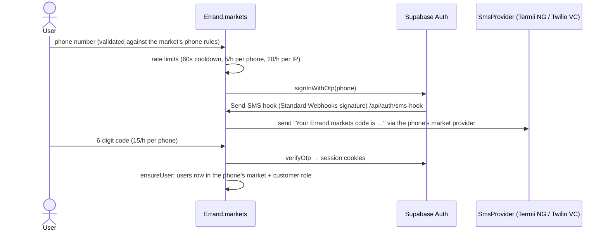
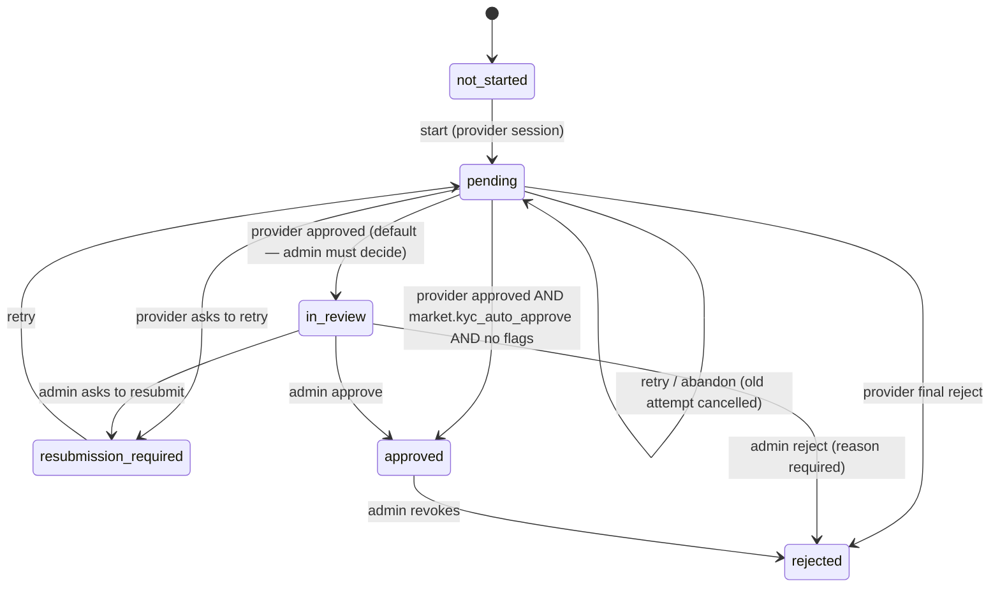

# 10 — Identity, auth & KYC (as built in Stage 3)

## Sign-in (Q0 = Option A)



- **Two gateways, one contract** (`src/server/auth`): `SupabaseAuth` (production) and `LocalAuth` (dev/sandbox: hashed OTPs in `auth.local_otp_challenges`, 5-minute expiry, 5 attempts, HS256 session JWT with the same claims as Supabase). `AUTH_MODE=local` is refused on production deploys.
- **Supabase path not yet run against a real project.** It is written to the documented `@supabase/ssr` and Standard Webhooks contracts and is covered by a signature round-trip test only.
- The phone number travels between "send code" and "enter code" in a 10-minute signed httpOnly cookie, never in the URL.
- `next` redirects are allow-listed to `/{locale}/…` after URL normalisation (open-redirect test included).

## Google sign-in

```mermaid
sequenceDiagram
  actor U as User
  participant App as Errand.markets
  participant SB as Supabase Auth
  participant G as Google
  U->>App: "Continue with Google" on /{locale}/{market}/sign-in
  App->>SB: signInWithOAuth(google, redirectTo=/api/auth/google/callback?locale&market&next)
  SB->>G: consent
  G->>SB: identity (email, name)
  SB->>App: /api/auth/google/callback?code=…
  App->>SB: exchangeCodeForSession(code) (PKCE)
  App->>App: ensureUser: users row in the market they signed in from, Google name, email, NO phone
  Note over U,App: browsing is open; posting an errand or becoming a Runner first needs a verified phone
  U->>App: /account/phone → number → 6-digit code
  App->>SB: updateUser({phone}) → Send-SMS hook → verifyOtp(type phone_change)
  App->>App: linkVerifiedPhone (never replaces a number; a number on another account is refused)
```

- **Why a phone is still required to transact:** customers and Runners must be able to reach each other, Runner KYC and payouts are tied to the phone, and SMS is our fallback channel. `requireVerifiedPhone` guards posting and every Runner page/action, and DB triggers (migration 0008) refuse errands, Runner roles and Runner profiles for users without `phone_e164`. Users can't write `phone_e164` themselves (column grants); only the verified-OTP path can.
- **Market** for Google users is the market they signed in from (not inferable from a phone). The phone they add must belong to one of that market's `phone_regions`.
- **Same person, two accounts?** Google and phone sign-ins are separate identities. If a Google user tries to add a number that already has an account, they're told to sign in with that number instead. We don't merge accounts automatically.
- **Local mode** has no Google: "Continue with Google" opens a labelled sandbox page (`/sign-in/google-sandbox`, 404 outside local auth) that signs in with any email, the way a Google identity arrives.
- **Shown when** `AUTH_MODE=local`, or in Supabase mode when `AUTH_GOOGLE_ENABLED=1`. Setup: create a Google OAuth client (Web), add Supabase's callback URL to it, enable the Google provider in Supabase with the client ID/secret, and add `{APP_URL}/api/auth/google/callback` to Supabase's redirect allow-list.
- **Not yet run against a real Supabase project or Google client.** In particular the Send-SMS hook payload field for phone changes (`user.phone_change`) must be confirmed.

## Roles & profiles

- First sign-in creates `users` (home market = the phone's market, or for Google the market signed in from) + `customer` role + `customer_profiles`.
- "Become a Runner" requires a verified phone, then adds the `runner` role + `runner_profiles` (in the user's market only, enforced by DB trigger). The profile has service areas (own market only, trigger), vehicle, bio and an optional emergency contact.
- Admins: `admin` role + `admin_grants(market_id NULL = all, permissions)`. Bootstrap with `pnpm admin:grant --phone … --market <CODE>|ALL --perms ops`. Admin pages return 404 to everyone else.
- A signed-in user opening another market's URL is redirected to the same page in their own market.

## How access control is layered

1. **Zod** on every action input.
2. **Server guards** (`requireAccount`, `requireVerifiedPhone`, `requireAdmin(perm)`) on every page and action. Admin scope is re-checked inside `decideVerification`.
3. **Postgres RLS**: user requests run as role `authenticated` with the user's JWT claims (`asUser`), so policies apply to server code, not just browser clients. Privileges start from `revoke all`, and clients get only listed columns (e.g. users can't update `kyc_status`).
4. **Triggers** for invariants: same-market Runner profile, service areas and KYC rows, verified phone for errands and Runners, plus an append-only admin audit log.
5. An **integration test pins the exact privilege list** for `anon` / `authenticated`. Supabase grants new `public` tables to those roles by default, so every new table must be explicitly revoked or granted, or this test fails.

## KYC



- Flags computed for the reviewer: `underage` (from `runner_rules.min_age_years`), `duplicate_identity` (keyed hash of the ID number already approved on another account), `name_mismatch`, `failed_checks`, `missing_date_of_birth`.
- Stored: a normalised summary (checks, document type, name on document, age in years, flags) and an HMAC of the ID number. **Not stored:** raw ID numbers, dates of birth or images (those stay with Dojah/Sumsub). Webhook payloads are redacted before storage.
- Webhooks: `/api/webhooks/{provider}/{market}` → signature check on the raw body → dedupe on `(provider, event_id)` → apply → `processed`. Duplicates are no-ops, failures are recorded and retried, and late events after an admin decision are ignored.
- **Sandbox provider** (`sandbox-kyc`): the Runner is sent to a local page to pick the outcome, which posts a *signed* webhook through the same pipeline.
- Dojah and Sumsub adapters are **UNVERIFIED** against live docs (unreachable from the build environment). They're unit-tested against my implementation of their documented schemes, and every assumption is listed at the top of each adapter file.

## Local development

`pnpm db:local:reset` applies `db/local/supabase-shim.sql` (local only: roles `anon`/`authenticated`/`service_role`, `auth.users`, `auth.uid()`), then the migrations, then the seed. The same migrations run unchanged on Supabase.
