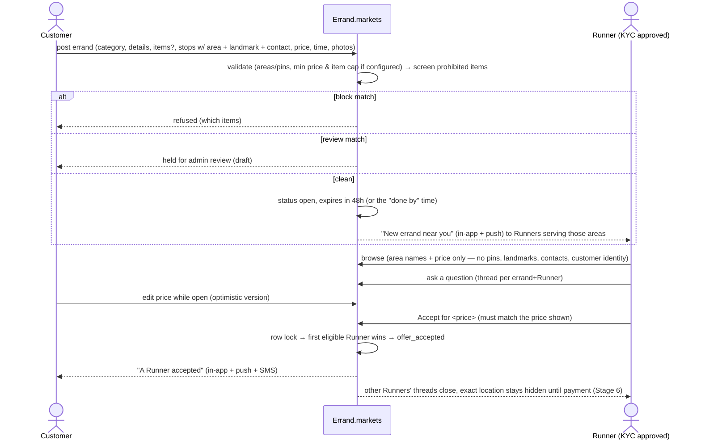

# 11 — Errand marketplace (as built in Stage 4)

## Flow

## Decisions applied

- **Pricing:** the customer's price (`pricing_mode = fixed`). The first eligible Runner wins (row lock + a unique "one accepted offer per errand" index). Counter-offers stay switched off via `runner_rules.pricing_control`.
- **Fees (decided 2026-11-26):** 5% service fee on the errand price, paid by the customer, with **no minimum price**. Commission is `0`. Item cap is still NULL (not decided). Customers see a live breakdown (price + fee + items estimate = total) before posting, and Runners see "You earn".
- **Payment order (decided):** the customer pays after a Runner accepts, including the item estimate. After acceptance an errand waits in `offer_accepted` until Stage 6 adds payment. The 30-minute funding timeout is **not active yet**: without payments it would bounce every accepted errand back to open.
- **Prohibited items:** the screening engine is live and tested, but the per-market lists are empty until legal provides them. Admins clear or reject held errands at `/en/admin/errands`.

## Privacy and access

| Data | Customer | Runner browsing | Assigned Runner | Admin (ops/support, own markets) |
|---|---|---|---|---|
| Title, price, category, area names, items, photos | ✓ | ✓ (safe projection) | ✓ | ✓ |
| Exact pin, landmark, contact phone (`places`) | ✓ | ✗ | only after **funded** | ✓ |
| Messages | own threads | own threads | own threads | support |

Enforced by RLS (`app.can_see_place`, `app.can_see_errand`, `app.is_conversation_participant`), with service-level projections for browsing. Integration tests assert that a Runner can't read open errands or places directly.

## Database guarantees

- Legal state transitions: `app.errand_transition_allowed` trigger. A test asserts it is identical to `TRANSITIONS` in TypeScript.
- Same market everywhere: errand ↔ customer ↔ Runner ↔ offer ↔ place ↔ service area (triggers).
- `errand_events` and `messages` are append-only.

## Locations

Every stop has a **service area** (required), a **pin** and a **landmark note** (required), plus an optional contact name and phone. The pin comes from the device's GPS if it falls inside one of our areas (checked against the area boundary), otherwise it's the area centre. **Area boundaries are approximate circles** (`boundary_status = 'approximate'`) until real neighbourhood boundaries are drawn. A Google Maps picker can replace this once a browser key exists.

## Images

Uploads are downscaled on the device first (long edge 1600px). The server then verifies the image by decoding it (JPEG, PNG or WebP only), applies EXIF rotation, **strips all metadata including GPS**, re-encodes as WebP (q72) and stores it privately (Supabase Storage in production, local disk in sandbox). Images are served only through `/api/media/:id` after an access check. Reference photos of an *open* errand are visible to verified Runners of that market only.

## Messaging and notifications

- One thread per (errand, Runner). It's read-only once another Runner is chosen or the errand expires. Block and report are on every thread, and a block also prevents accepting.
- Live updates: polling every 4 seconds while the tab is visible. Supabase Realtime broadcast triggers and channel policies are in the migration and only switch on where the `realtime` schema exists (**not yet run on Supabase**).
- Notifications are stored in-app. Delivery channels per type: push for most, and SMS only for acceptances, KYC decisions and rejections. Repeated chat alerts are merged into one unread notification per thread.
- Delivery runs through Inngest (`notifications/deliver`, retries) or in-process without Inngest keys. The sweeper (Inngest cron every 5 minutes, plus `/api/cron/sweep` as a backstop) expires errands.
- Web Push uses standard VAPID, so no vendor account is needed. Without keys, pushes are recorded in the sandbox outbox. The service worker also serves an offline page.
