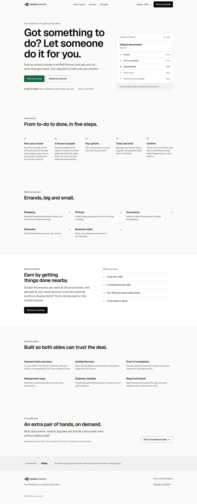
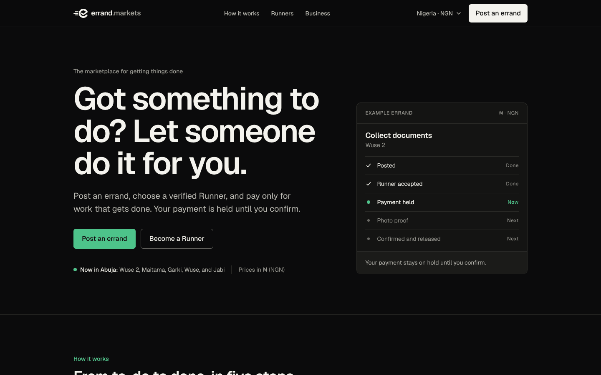

# Design system — Stage 2

Live reference: `/en/design` (tokens, type scale, components and the hero). Source of truth for colours is [`src/ui/tokens.ts`](../../src/ui/tokens.ts). Contrast for every pair the UI uses is unit-tested ([`tests/unit/tokens.test.ts`](../../tests/unit/tokens.test.ts)).

## Chosen direction: A · Ledger

Chosen in Stage 2 (2026-11-26). Reads like a bank statement: calm, exact, accountable. The hero's "example errand" panel explains the held payment in type alone.

- **Typeface:** Geist
- **Base:** warm paper `#FAFAF7`, ink `#0B0B0C`
- **Accent:** deep "money" green `#0F6B45` (dark mode `#4CC38A`)
- **Radius:** 6px

| Desktop (NG) | Dark (NG) |
|---|---|
|  |  |

Mobile: [VC](screens/A-ledger-mobile-full-VC.png). QA: [RTL pseudo-locale](screens/rtl-pseudo-mobile.png) · [long-string pseudo-locale](screens/long-pseudo-mobile.png) · [market picker](screens/market-picker.png) · [design system page](screens/design-system.png).

## Foundations

- **Colour tokens:** `bg`, `surface`, `sunken`, `ink`, `ink-2`, `ink-3`, `line` (decorative hairline), `line-strong` (control borders, ≥3:1), `accent`, `accent-ink`, `accent-soft`, `accent-text`, `danger`, `focus`. Tailwind's default palette is switched off (`--color-*: initial`), so no off-token colour can be used. Light and dark follow the system setting.
- **Type scale (fluid):** display 40→76px / h1 32→48 / h2 26→36 / h3 18 / lead 17→20 / body 16 / small 14 / micro 12. Tight negative tracking on headings, reset to 0 for Arabic/Hebrew/Persian/Urdu.
- **Space and layout:** 4px grid; container max 72rem with gutters of 16px (phone) / 24 / 32; sections 64→96px vertical; hairline separators instead of cards.
- **Motion:** 150 / 200 / 250 ms, `cubic-bezier(0.2,0,0,1)`. Everything is disabled under `prefers-reduced-motion`.
- **Accessibility:** WCAG AA contrast (tested), ≥44px targets on all interactive elements, visible focus ring, skip link, landmarks, and native `
` menus that work without JavaScript. axe-core: 0 violations on the home (both markets, light and dark), the picker and RTL.
- **RTL / long strings:** logical properties only (`ms-`/`me-`/`start`/`end`). Directional icons mirror. The logo never mirrors. Pseudo-locales `en-XA` (+50% length) and `ar-XB` (RTL) can be enabled with `ENABLE_PSEUDO_LOCALES=1` (never in production).

## Components (so far)

`Button` (primary · ink · secondary · ghost; md 44px · lg 48px; `asChild` for links) · `Badge` (neutral · accent · outline) · `Container` · `SectionHeading` · `Logo` / `LogoMark` (vector trace of the supplied logo, `currentColor`) · `MarketSwitcher` · icons (check, arrow, chevron, menu, dot). These are shadcn-style primitives (Radix Slot + cva), restyled to our tokens. More shadcn primitives (input, dialog, sheet, toast) arrive with the screens that need them.
